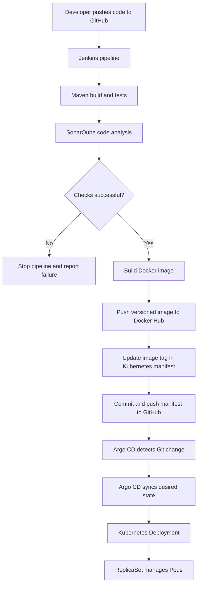

# Spring Boot CI/CD with Jenkins, Docker, SonarQube, Kubernetes, and Argo CD

## 1. Project Overview

Built a CI/CD workflow for a Spring Boot application. Jenkins builds and analyzes the code, creates a Docker image, pushes it to Docker Hub, updates the Kubernetes deployment manifest in GitHub, and Argo CD syncs the desired configuration to Kubernetes.

### Tools Used

- **Jenkins** — automates the pipeline
- **Maven** — builds the Spring Boot application
- **SonarQube** — analyzes code quality
- **Docker** — packages the application into a container image
- **Docker Hub** — stores container images
- **GitHub** — stores application code and Kubernetes manifests
- **Kubernetes** — runs the application using Deployments, ReplicaSets, and Pods
- **Argo CD** — syncs Kubernetes configuration from GitHub using GitOps

## 2. End-to-End Workflow



**Important:** Jenkins builds and publishes the image. Argo CD deploys the Kubernetes configuration from GitHub. Argo CD does not build the Docker image.

## 3. Step-by-Step Implementation

### Step 1 — Prepare the application and GitHub repository

- Stored the Spring Boot application, `pom.xml`, application `Dockerfile`, and Jenkins pipeline file in GitHub.
- Kept Kubernetes manifests in a separate directory:
  `java-maven-sonar-argocd-helm-k8s/spring-boot-app-manifests/`.
- Used Git to version-control application code and deployment configuration.

### Step 2 — Configure Jenkins

- Created a Jenkins pipeline job connected to the GitHub repository.
- Configured credentials for SonarQube, Docker Hub, and GitHub.
- Used a Docker-based Jenkins agent containing Java and Maven tools.
- Mounted `/var/run/docker.sock` into the agent so its Docker CLI could communicate with the Docker daemon on the EC2 host.

### Step 3 — Build the application with Maven

- Ran Maven from the Spring Boot application directory.
- Verified that the application compiled successfully before continuing the pipeline.

### Step 4 — Run SonarQube analysis

- Set up SonarQube on the EC2 host.
- Added the SonarQube token to Jenkins credentials.
- Configured the pipeline to run the Maven SonarQube scanner.
- Verified successful scanner execution in the Jenkins build log.

### Step 5 — Build and push the Docker image

- Used the application Dockerfile to package the compiled Spring Boot JAR into a container image.
- Tagged each image using the Jenkins build number, for example:
  `nikhilb619/spring-boot-cicd:23`.
- Authenticated to Docker Hub using a Jenkins credential and pushed the image to the repository.

**Note:** The application Dockerfile and Jenkins agent image serve different purposes:
- The **application image** contains the Spring Boot JAR and Java runtime.
- The **Jenkins agent image** provides tools such as Java, Maven, and the Docker CLI used by the pipeline.

### Step 6 — Update the Kubernetes deployment manifest

- Updated `spring-boot-app-manifests/deployment.yml` with the image repository and build-specific tag.
- Configured the pipeline to commit and push the updated manifest to GitHub.
- Used Git credentials stored in Jenkins rather than hard-coding a personal access token in the repository.

Example image reference:

```yaml
image: nikhilb619/spring-boot-cicd:23
```

### Step 7 — Configure Argo CD

- Used an Argo CD instance managed by the Argo CD Operator.
- Created an Argo CD `Application` pointing to the GitHub repository and Kubernetes manifest path.
- Enabled automated synchronization.
- Confirmed the application reported **Synced** and **Healthy** in the Argo CD UI.

### Step 8 — Verify the Kubernetes deployment

- Verified the `spring-boot-app` Deployment and its Pods.
- Observed the relationship:
  `Deployment → ReplicaSet → Pods`.
- Confirmed that the desired replica count matched the running Pods.
- Tested GitOps by changing the replica count in GitHub and checking that Argo CD synchronized the change to Kubernetes.

## 4. Challenges and How They Were Resolved

### Challenge 1 — Docker CLI and daemon API mismatch

**Problem:** The Docker CLI inside the Jenkins agent was version `20.10.21` (API `1.41`), while the EC2 Docker daemon required API `1.44` or newer.

**Resolution:** Identified that the outdated CLI was inside the agent container, not the host installation. Prepared a separate custom Jenkins agent image with a newer Docker CLI.

**What this demonstrates:** Troubleshooting containerized build environments and understanding the difference between a Docker CLI and the Docker daemon.

### Challenge 2 — Docker Hub image naming and push permissions

**Problem:** Incorrect image naming caused Docker to interpret the username and repository incorrectly. A push also failed with `insufficient_scope`.

**Resolution:** Corrected the image naming format to `username/repository:tag`, checked the Docker Hub repository, and verified that the Jenkins credential used a Docker Hub access token with write permission.

**What this demonstrates:** Container image tagging, registry authentication, and credential troubleshooting.

### Challenge 3 — Git commit failed because there were no changes

**Problem:** The pipeline tried to commit a deployment manifest after the placeholder had already been replaced, so Git reported that there was nothing to commit. Some runs also checked out a detached or older commit.

**Resolution:** Updated the manifest logic to replace the current image tag and added a check to commit only when staged changes exist. The checkout behavior should also be kept consistent with the latest `main` branch to avoid stale commits.

**What this demonstrates:** Git state management and making CI/CD stages more reliable and repeatable.


## 5. Key Concepts Learned

- CI/CD pipeline stages and Jenkins credentials
- Maven build lifecycle and SonarQube code analysis
- Docker image creation, tagging, and registry pushes
- Kubernetes Deployments, ReplicaSets, and Pods
- GitOps and Argo CD automatic synchronization
- Updating deployment configuration through Git
- Debugging Docker API compatibility, registry authentication, and Git commit failures

## 6. Proof of Implementation

Screenshots below show the successful Jenkins pipeline, Argo CD application health/sync status, the EC2 instance running Jenkins, and the overall workflow diagram.

### Jenkins pipeline — successful build


### Argo CD — application healthy and synced


### EC2 — Jenkins instance running


### CI/CD architecture flowchart


## 7. Final Outcome

Implemented and verified a workflow in which Jenkins builds and analyzes the Spring Boot application, publishes a versioned Docker image, and updates the Kubernetes manifest in GitHub. Argo CD detects the Git change and synchronizes the desired configuration to Kubernetes, where the Deployment manages the application Pods.
